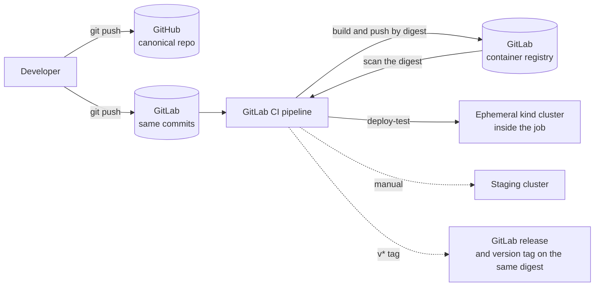
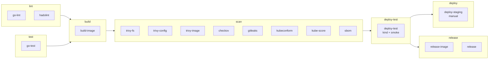

# orders-api-pipeline

[](https://gitlab.com/abhichandra-v/orders-api-pipeline/-/pipelines)
[](LICENSE)

A GitLab CI/CD pipeline that builds a hardened container image, blocks the
release on security findings, and deploys to Kubernetes. The payload is a
small Go orders API; it is deliberately small, because the pipeline, the
image and the gates are the point.

| | |
|---|---|
| **Image** | 1020.32 MB naive → **7.30 MB** hardened (139.7 : 1), measured |
| **Gates** | 7 scan gates, plus lint and tests; any finding fails the pipeline |
| **Proof** | A branch with a vulnerable base image is blocked: 36 HIGH/CRITICAL findings, exit code 1 |
| **Deploy** | Ephemeral Kubernetes cluster per pipeline, smoke test, manual staging deploy, tag-based release |

Every number on this page comes from a file in [`docs/evidence/`](docs/evidence/).

> **What has and has not been run.** Everything here has been run locally, in
> the same pinned tool images the pipeline uses, and the evidence files are
> that output. The pipeline has **not yet run on GitLab**, so the badge above
> will not resolve and the three screenshots below are placeholders until the
> project is created and pushed ([docs/SETUP-GITLAB.md](docs/SETUP-GITLAB.md)).

## Architecture



The service itself: Go standard library only, five endpoints
(`POST /orders`, `GET /orders`, `GET /orders/{id}`, `GET /healthz`,
`GET /readyz`), in-memory store, JSON logs, configuration from environment
variables, graceful shutdown on SIGTERM.

## Pipeline



Stage-by-stage reasoning: [docs/PIPELINE.md](docs/PIPELINE.md).

## Image size: before and after

Source: [`docs/evidence/image-size.txt`](docs/evidence/image-size.txt),
written by `make size-report`. Sizes are **uncompressed, local** sizes (the
sum of each image's decompressed layers), not registry sizes.

| Image | Dockerfile | Bytes | Size |
|---|---|---:|---:|
| Naive: single stage on the full `golang` image | [`build/naive/Dockerfile`](build/naive/Dockerfile) | 1,020,324,864 | 1020.32 MB |
| Distroless static (measured for comparison) | [`build/distroless/Dockerfile`](build/distroless/Dockerfile) | 10,481,152 | 10.48 MB |
| **Hardened: static binary on `scratch`** | [`Dockerfile`](Dockerfile) | **7,301,120** | **7.30 MB** |

Ratio 139.7 : 1, a 99.28% reduction. The hardened image is one layer holding
one file, the 7,299,232-byte binary.

How it gets there, and what each step is for:

| Step | Effect |
|---|---|
| Multi-stage build | The Go toolchain and source stay in the build stage |
| `CGO_ENABLED=0` | A static binary with no libc dependency, so it can run on an empty base |
| `FROM scratch` | No shell, no package manager, no OS packages |
| `-trimpath -ldflags "-s -w"` | No build paths, symbol table or debug information |
| `USER 65532:65532` | Non-root, as a numeric UID Kubernetes can verify |
| Base images pinned by digest | A re-pushed tag cannot change the build |

It runs with `--read-only --cap-drop ALL --user 65532:65532`:
[`image-run-hardened.txt`](docs/evidence/image-run-hardened.txt). It has no
shell to start: [`image-contents.txt`](docs/evidence/image-contents.txt).

## Security gates

Every job below exits non-zero on a finding, and none is allowed to fail.

| Control | What it catches | Job |
|---|---|---|
| Go static analysis, including `gosec` | Unchecked errors, unsafe patterns, unclosed bodies | `go-lint` |
| Dockerfile lint | Unpinned bases, shell pitfalls | `hadolint` |
| Unit tests with the race detector | Regressions and data races (78 tests, 91.4% statement coverage) | `go-test` |
| Filesystem scan | Vulnerable Go modules, secrets in the tree, Dockerfile misconfigurations | `trivy-fs` |
| Secret scan over full history | Secrets in any commit, including deleted ones | `gitleaks` |
| Config scan | Misconfigured Dockerfiles and Kubernetes manifests | `trivy-config` |
| Policy scan | Violations in Dockerfiles, manifests and the pipeline definition itself | `checkov` |
| Schema validation, strict | Typos and unknown fields `kubectl apply` would silently drop | `kubeconform` |
| Best-practice scoring | Missing probes, limits, PDB, NetworkPolicy; weak security context | `kube-score` |
| **Image scan** | HIGH/CRITICAL CVEs with a fix, in the exact digest that was pushed | `trivy-image` |
| SBOM (records, does not gate) | Component inventory for later CVE lookups | `sbom` |
| Deploy to a real cluster | A pod that validates but does not start, wrong probes, unenforced policies | `deploy-test` |

**The gate demonstrably blocks.** The `demo/vulnerable-base` branch changes
one line, swapping the runtime base for end-of-life `alpine:3.12.0`. Lint,
config scans and Checkov still pass on it. The image scan does not:

```
orders-api:vulnerable-demo (alpine 3.12.0)
Total: 36 (HIGH: 32, CRITICAL: 4)
GATE FAILED: orders-api:vulnerable-demo has HIGH or CRITICAL vulnerabilities with a fix available.
exit code: 1
```

Full log, with the passing run of the hardened image beside it:
[`gate-blocks-vulnerable-image.txt`](docs/evidence/gate-blocks-vulnerable-image.txt).
That run was local, using the script the pipeline job calls.

Suppressions need a justification and a review date, and Trivy's expire on
that date. The current list, and what each control does **not** catch, is in
[docs/SECURITY.md](docs/SECURITY.md).

## Kubernetes

`k8s/base` with `dev` and `prod` kustomize overlays. The pod runs non-root
with a read-only root filesystem, no privilege escalation, all capabilities
dropped and the `RuntimeDefault` seccomp profile, in a namespace that enforces
the `restricted` Pod Security Standard. It has requests and limits, startup,
liveness and readiness probes, no service account token, a
PodDisruptionBudget and a default-deny NetworkPolicy with one allow rule.

| Check | Result | Evidence |
|---|---|---|
| kubeconform `-strict`, both overlays | 14 resources valid, 0 invalid | [`k8s-validate.txt`](docs/evidence/k8s-validate.txt) |
| kube-score `--exit-one-on-warning`, both overlays | No warnings | [`k8s-validate.txt`](docs/evidence/k8s-validate.txt) |
| Checkov, kubernetes framework | 272 passed, 0 failed, 4 documented skips | [`k8s-validate.txt`](docs/evidence/k8s-validate.txt) |
| Deploy to kind and smoke test | Rolled out, 7 of 7 checks pass | [`kind-deploy-smoke.txt`](docs/evidence/kind-deploy-smoke.txt) |
| NetworkPolicy enforcement | In-cluster client allowed; egress from the namespace blocked | [`kind-deploy-smoke.txt`](docs/evidence/kind-deploy-smoke.txt) |
| Rollback with `kubectl rollout undo` | Bad release never took capacity; undo restores in seconds | [`rollback.txt`](docs/evidence/rollback.txt) |

## Quick start

The only prerequisite is Docker. `scripts/toolbox.sh` runs each target in an
image that carries every tool at the version the pipeline uses.

```bash
scripts/toolbox.sh make doctor test image size-report scan
```

```bash
scripts/toolbox.sh make kind-up deploy smoke
```

```bash
scripts/toolbox.sh make kind-down
```

With Go, Docker, kind, kubectl, Trivy, hadolint and the other tools installed
locally, drop the `scripts/toolbox.sh` prefix. `make doctor` lists what is
missing; `make help` lists every target.

| Target | Does |
|---|---|
| `doctor` | Checks the toolchain |
| `lint` | golangci-lint, hadolint, yamllint |
| `test` | `go vet`, unit tests with the race detector and coverage |
| `image` | Builds the hardened image |
| `size-report` | Builds all three images, writes `docs/evidence/image-size.txt` |
| `scan` | Every scan gate the pipeline runs |
| `validate` | kubeconform, kube-score and Checkov on the rendered overlays |
| `kind-up` / `deploy` / `smoke` | Local cluster, dev overlay, smoke test |
| `netpol-check` | Proves the NetworkPolicies are enforced |

Output of the full run (the header records the commit; only docs changed after it):
[`local-full-run.txt`](docs/evidence/local-full-run.txt).

## GitHub and GitLab

GitHub (`github.com/abhichandra-v/orders-api-pipeline`) is the canonical,
public home of the code. GitLab runs the pipeline from the same commits: the
repository has two remotes, `origin` (GitHub) and `gitlab`, and both are
pushed. There is no mirroring and no GitHub Actions workflow; nothing runs
until the GitLab remote receives a push. The container registry and the
releases live on GitLab.

Setup: [docs/SETUP-GITLAB.md](docs/SETUP-GITLAB.md).

## Pipeline screenshots

Placeholders until the pipeline has run on GitLab. The files do not exist yet.

| Screenshot | File |
|---|---|
| ⏳ **PLACEHOLDER**: green pipeline on `main` | `docs/evidence/screenshots/pipeline-green.png` |
| ⏳ **PLACEHOLDER**: `demo/vulnerable-base` pipeline blocked at `trivy-image` | `docs/evidence/screenshots/pipeline-gate-blocked.png` |
| ⏳ **PLACEHOLDER**: container registry tags | `docs/evidence/screenshots/registry.png` |

## Evidence index

| Claim | File |
|---|---|
| The API works: every endpoint, error cases, graceful shutdown | [`api-smoke.txt`](docs/evidence/api-smoke.txt) |
| Image sizes, ratio, base image digests | [`image-size.txt`](docs/evidence/image-size.txt) |
| One layer, non-root user, healthcheck | [`image-history.txt`](docs/evidence/image-history.txt), [`image-inspect.txt`](docs/evidence/image-inspect.txt) |
| One file in the image; no shell | [`image-contents.txt`](docs/evidence/image-contents.txt) |
| Runs read-only, no capabilities, non-root | [`image-run-hardened.txt`](docs/evidence/image-run-hardened.txt) |
| Lint, tests (coverage), scans and validation all pass | [`local-full-run.txt`](docs/evidence/local-full-run.txt) |
| 78 tests pass under the race detector, 91.4% coverage | [`go-test.txt`](docs/evidence/go-test.txt) |
| The image gate blocks a vulnerable image | [`gate-blocks-vulnerable-image.txt`](docs/evidence/gate-blocks-vulnerable-image.txt) |
| SBOM contents | [`image-sbom-summary.json`](docs/evidence/image-sbom-summary.json) |
| Manifests pass kubeconform, kube-score, Checkov | [`k8s-validate.txt`](docs/evidence/k8s-validate.txt) |
| Deploy to kind, pod security context, NetworkPolicy enforcement | [`kind-deploy-smoke.txt`](docs/evidence/kind-deploy-smoke.txt) |
| The deploy-test job's steps work inside docker-in-docker | [`deploy-test-dind-rehearsal.txt`](docs/evidence/deploy-test-dind-rehearsal.txt) |
| Staging deploy: skip, validation, dry run, failed rollout | [`deploy-staging-paths.txt`](docs/evidence/deploy-staging-paths.txt) |
| Rollback | [`rollback.txt`](docs/evidence/rollback.txt) |

Not yet evidenced, because it needs the GitLab project: a green pipeline, the
blocked pipeline, the registry contents, a tag release, and a staging deploy
to a real cluster.

## Documentation

- [docs/PIPELINE.md](docs/PIPELINE.md): each stage and the reasoning for each gate
- [docs/SECURITY.md](docs/SECURITY.md): what each control catches and what it does not
- [docs/RUNBOOK.md](docs/RUNBOOK.md): failed scans, rollback, rotating variables, updating pins
- [docs/SETUP-GITLAB.md](docs/SETUP-GITLAB.md): creating the GitLab project and running the pipeline
- [docs/DECISIONS.md](docs/DECISIONS.md): decision log
- [docs/PLAN.md](docs/PLAN.md): build plan and what is still open

## Layout

```
├── Dockerfile                # hardened image
├── build/naive/              # comparison image (never deployed)
├── build/distroless/         # comparison image (never deployed)
├── build/toolbox/            # pinned local toolchain
├── cmd/orders-api/           # main, graceful shutdown, healthcheck
├── internal/                 # handlers, store, config
├── k8s/base/                 # manifests
├── k8s/overlays/{dev,prod}/  # kustomize overlays
├── scripts/                  # smoke, size report, kind, deploy, gates
├── .gitlab-ci.yml            # the pipeline
└── docs/                     # docs and evidence
```

## License

[MIT](LICENSE)
