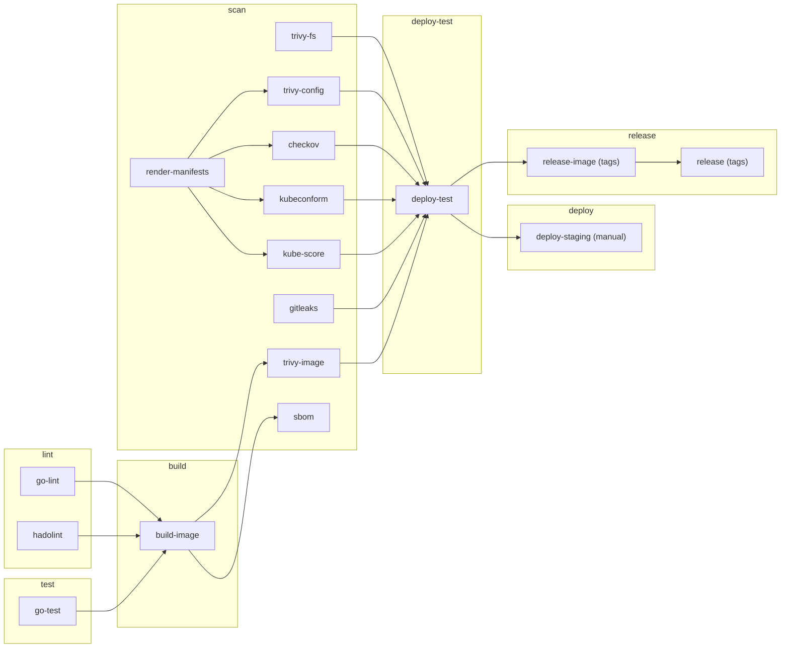

# Pipeline

How [`.gitlab-ci.yml`](../.gitlab-ci.yml) is put together, stage by stage,
and why each gate is there.

> **Status of this document.** Every job's commands have been run locally in
> the same pinned image the job uses, and the deploy test has been rehearsed
> against a real `docker:dind` service. The pipeline has **not yet run on
> GitLab**: that needs the project owner's account
> ([SETUP-GITLAB.md](SETUP-GITLAB.md)). Where behaviour depends on GitLab
> itself (registry login with the job token, artifact hand-off, the release
> API), it is described as designed, not as observed.

## Shape



Arrows are `needs:` edges. The pipeline is a DAG, not a strict
stage-by-stage sequence: `trivy-fs`, `gitleaks` and `render-manifests` have
`needs: []` and start at the same moment as the lint jobs, so a leaked secret
or a bad manifest is reported in the first minute rather than after the image
build.

## When pipelines run

```yaml
workflow:
  rules:
    - if: $CI_PIPELINE_SOURCE == "merge_request_event"
    - if: $CI_COMMIT_BRANCH && $CI_OPEN_MERGE_REQUESTS
      when: never
    - if: $CI_COMMIT_BRANCH
    - if: $CI_COMMIT_TAG
```

One pipeline per change. A branch with an open merge request gets a merge
request pipeline and no duplicate branch pipeline; a branch without one gets
a branch pipeline; a tag gets a tag pipeline. Jobs use `rules:` throughout,
never `only`/`except`.

## Conventions

| Convention | Why |
|---|---|
| Every image is `tag@sha256:digest`, defined once in `variables:` | A re-pushed tag cannot change what a job runs; one place to update |
| Release binaries (kind, kubectl) go through `scripts/fetch-verified.sh` | Nothing downloaded at job time is executed without a SHA-256 match |
| Tools that ship an entrypoint use `entrypoint: [""]` | GitLab needs a shell to run `script:` |
| Scan jobs write JSON, then gate on `trivy convert --exit-code 1` | The table in the log, the artifact and the GitLab report come from one scan (D-013) |
| Later jobs receive the image as `IMAGE_REF` (`repository@sha256:…`) | They scan, test and deploy the bytes that were built, not whatever a tag points to later |
| `interruptible: true` by default; off for deploy and release | A newer commit cancels stale pipelines, but never a deploy halfway through |
| `retry` only on `runner_system_failure` and `stuck_or_timeout_failure` | Infrastructure flakes are retried; a failing test or scan is not |

## Stage: lint

| Job | Image | Fails on |
|---|---|---|
| `go-lint` | golangci-lint | Any issue from `.golangci.yml` (standard set plus `gosec`, `bodyclose`, `errorlint`, `noctx`, `revive`, `misspell`, `unconvert`, and `gofmt`) |
| `hadolint` | hadolint | Any warning in any of the four Dockerfiles |

**Why first:** these take seconds and need nothing built. Formatting and
obvious mistakes should not cost a full image build to discover.

**Why lint the comparison Dockerfiles too:** an unpinned base is a mistake in
any Dockerfile in the repo, including the ones that are never deployed.

## Stage: test

`go-test` runs `go vet`, then the unit tests under `gotestsum`:

```
gotestsum --format testname --junitfile junit.xml -- \
  -race -count=1 -covermode=atomic -coverprofile=coverage.out ./...
```

- `-race` is why this job uses the Debian Go image, not Alpine: the race
  detector needs cgo and a C compiler (D-011).
- `junit.xml` is uploaded as a JUnit report, so failures show in the merge
  request and the pipeline's **Tests** tab.
- The `coverage:` regex reads the `total:` line of `go tool cover -func`, so
  GitLab shows and tracks the percentage. `coverage.html` is kept as an
  artifact.
- Go module and build caches live under the project directory (`.go/`,
  `.cache/`) and are cached with a key derived from `go.mod`.

**Why it gates the build:** `build-image` `needs` both lint jobs and
`go-test`. An image is not built or pushed from code that does not pass its
own tests.

## Stage: build

`build-image` uses `docker:cli` with a `docker:dind` service. The job and the
daemon talk over TLS (`DOCKER_TLS_CERTDIR=/certs`, port 2376); the plaintext
2375 socket is never opened.

It builds the root [`Dockerfile`](../Dockerfile) with `--pull`, labels the
image with the source URL, commit and build time, and pushes two tags to the
project registry:

| Tag | Purpose |
|---|---|
| `$CI_COMMIT_SHORT_SHA` | Immutable handle for this commit |
| `$CI_COMMIT_REF_SLUG` | Moving "latest on this branch" (for example `main`) |

It then reads the pushed digest and exports it two ways: a dotenv report
(`IMAGE_REF=repository@sha256:…`), which GitLab injects into every job that
`needs` this one, and `image-digest.txt` as a plain artifact.

**Why the digest matters:** a tag can be moved between the build and the
deploy. Every later job that touches the image uses `IMAGE_REF`, so "the image
that was scanned" and "the image that was deployed" are the same by
construction.

**Why push before scanning:** the scan needs the image somewhere it can be
pulled by digest, and the registry is that place. The image is tagged only by
commit and branch at this point; nothing deploys it until the gates pass, and
the version tag is added only by `release-image`.

Registry login uses the job token (`CI_REGISTRY_USER` /
`CI_REGISTRY_PASSWORD`, passed on stdin). No registry credential is stored in
project variables.

## Stage: scan

Nine jobs. Seven are gates: they exit non-zero on a finding and none is
`allow_failure`. `render-manifests` produces input for others, and `sbom`
records.

| Job | Needs | What it does | Why it is a gate |
|---|---|---|---|
| `trivy-fs` | — | `trivy fs --scanners vuln,secret,misconfig` on the repository | Vulnerable Go modules and secrets in the tree are cheapest to fix before an image exists |
| `gitleaks` | — | Full git history (`GIT_DEPTH: 0`) | A secret deleted in a later commit is still public; only a history scan sees it |
| `render-manifests` | — | `kustomize build` of both overlays into `rendered/` (artifact) | Not a gate. Makes every validator judge the same rendered bytes (D-015) |
| `trivy-config` | render-manifests | Misconfiguration scan of Dockerfiles, raw manifests and rendered overlays | Catches a pod that would run as root or without limits before it reaches a cluster |
| `checkov` | render-manifests | `dockerfile`, `kubernetes` and `gitlab_ci` frameworks | A second, independent rule set, and the only tool that checks the pipeline definition itself |
| `kubeconform` | render-manifests | Schema validation, `-strict`, against Kubernetes 1.37 | A misspelled field is silently ignored by `kubectl apply`; strict validation makes it an error |
| `kube-score` | render-manifests | Best-practice scoring with `--exit-one-on-warning` | Reliability rules the security scanners do not have: probes, PDB, anti-affinity, pull policy |
| `trivy-image` | build-image | `scripts/scan-image.sh "$IMAGE_REF"`: HIGH and CRITICAL, fixable only | The only job that sees what is actually in the image: base OS packages and the Go standard library compiled into the binary |
| `sbom` | build-image | CycloneDX SBOM of the image, attached as a GitLab report | Not a gate. When a new CVE is announced, the SBOM answers "are we affected?" without a rescan |

**Two scanners for configuration (Trivy and Checkov) is deliberate.** Their
rule sets overlap but are not the same, and they have already disagreed in
this repo: Checkov asks for an image digest (CKV_K8S_43), Trivy flags the
registry as untrusted (KSV-0125), and neither reports the other's finding.

**Why `trivy-image` is narrower than the rest.** The other gates fail on any
finding. `trivy-image` fails on HIGH and CRITICAL with a fix available. A CVE
with no fix cannot be resolved by a commit, and a gate that cannot be
satisfied gets overridden or ignored; a fixable one always has an action.

**Suppressions** are allowed only with a justification and a review date;
Trivy's expire automatically. The list and the policy are in
[SECURITY.md](SECURITY.md#suppressions).

**Proof the gate blocks:**
[`evidence/gate-blocks-vulnerable-image.txt`](evidence/gate-blocks-vulnerable-image.txt).
The `demo/vulnerable-base` branch changes one line (the runtime base becomes
end-of-life `alpine:3.12.0`). Lint, config scans and Checkov all still pass on
it; the image scan fails with 36 findings. That is the case for having an
image scan at all: nothing else looks inside the base.

## Stage: deploy-test

`deploy-test` `needs` the image **and all seven gates** (D-019), then:

1. Installs kind and kubectl through `fetch-verified.sh`.
2. Pulls `IMAGE_REF` from the registry.
3. `scripts/kind-up.sh`: creates a one-node kind cluster inside the dind
   service, on a pinned node image.
4. `scripts/deploy.sh`: loads the image into the cluster, applies the dev
   overlay, waits for `kubectl rollout status`.
5. `scripts/smoke-k8s.sh`: port-forwards the Service and runs
   `scripts/smoke.sh` (health, readiness, create an order, fetch it, list,
   404 and 422 cases).
6. `scripts/netpol-check.sh`: checks the NetworkPolicies are enforced, not
   merely accepted.
7. `after_script`: on failure, collects `kubectl describe`, events and logs
   into a `diagnostics/` artifact. Always deletes the cluster.

**Why a real cluster and not just validation.** Static checks prove the
manifests are well-formed and follow the rules. They cannot prove the pod
starts under a read-only filesystem as a non-root user, that the probes hit
paths that exist, that the namespace's restricted policy admits it, or that
the Service selector matches. Only applying it does.

**The dind networking detail.** kind publishes the Kubernetes API on the
Docker host. In this job the Docker host is the `docker` service container,
not the job's `localhost`. `KIND_API_HOST=docker` makes `kind-up.sh` bind the
API server to all interfaces, add `docker` to its certificate SANs, and point
the kubeconfig at `https://docker:6443` (D-018).

**Rehearsed locally:**
[`evidence/deploy-test-dind-rehearsal.txt`](evidence/deploy-test-dind-rehearsal.txt)
is `scripts/sim-deploy-test.sh` running these steps against a real
`docker:dind` service with the pipeline's images. It is not a GitLab log.

## Stage: deploy

`deploy-staging` is a manual job on `main` and on `vX.Y.Z` tags, with
`environment: staging` and `resource_group: staging` (one deploy at a time).
It runs [`scripts/deploy-staging.sh`](../scripts/deploy-staging.sh):

- No `KUBECONFIG_B64` (masked, protected variable): prints a notice, exits 0.
  A project with no cluster still has a green pipeline (D-021).
- Otherwise: applies the prod overlay with the image pinned to `IMAGE_REF`,
  waits for the rollout, and on failure runs `kubectl rollout undo` and fails
  the job.

**Why manual.** The automated part ends at "this exact image passed every
gate and started correctly in a cluster". Putting it in front of users is a
decision, so it is a button. `allow_failure: true` on a manual job keeps an
unpressed button from marking the pipeline as blocked.

**Why the variable is protected.** A protected variable is only exposed to
pipelines on protected branches and tags. A merge request from a fork or a
feature branch cannot read the kubeconfig, whatever its `.gitlab-ci.yml`
says.

Rollback procedure and evidence: [RUNBOOK.md](RUNBOOK.md#rolling-back-a-bad-deploy).

## Stage: release

Tag pipelines for `vMAJOR.MINOR.PATCH` only.

| Job | What it does |
|---|---|
| `release-image` | `docker buildx imagetools create --tag …:$CI_COMMIT_TAG "$IMAGE_REF"`: adds the version tag to the existing manifest in the registry |
| `release` | Generates notes with `scripts/release-notes.sh` (image tag, digest, commits since the previous tag) and creates the GitLab release through the `release:` keyword |

**Why retag instead of rebuild.** A tag pipeline runs every stage, so by the
time `release-image` starts, one specific digest has been linted, tested,
scanned and deploy-tested. Rebuilding for the release would produce a
different image that had been through none of that (D-020).

## Local equivalents

Every job has a local counterpart with the same tool version and the same
configuration file. `scripts/toolbox.sh` runs them in the toolbox image, so
the only prerequisite is Docker.

| Pipeline | Local |
|---|---|
| `go-lint`, `hadolint` | `make lint` |
| `go-test` | `make test` |
| `build-image` | `make image` |
| `trivy-fs`, `trivy-config`, `trivy-image`, `checkov`, `gitleaks` | `make scan` |
| `sbom` | `make sbom` |
| `render-manifests`, `kubeconform`, `kube-score` | `make validate` |
| `deploy-test` | `make kind-up deploy smoke netpol-check`, or `bash scripts/sim-deploy-test.sh` for the dind variant |
| `deploy-staging` | `DRY_RUN=1 IMAGE_REF=… bash scripts/deploy-staging.sh` |

[`evidence/local-full-run.txt`](evidence/local-full-run.txt) is the output of
`make doctor lint test image scan validate`; its header records the commit.

## What the pipeline does not do

- **No image signing or provenance attestation.** The digest hand-off
  guarantees consistency inside one pipeline; it does not let a third party
  verify where an image came from. cosign with a GitLab ID token is the
  planned next step.
- **No dynamic or penetration testing.** The smoke test checks behaviour, not
  attack resistance.
- **No dependency update automation.** Pins are bumped by hand
  ([RUNBOOK.md](RUNBOOK.md#updating-pinned-versions)); Renovate is a possible
  addition.
- **No production deploy.** The furthest it goes is a manual staging deploy.
- **The GitHub repository runs nothing.** GitHub hosts the code; only the
  GitLab remote has a pipeline, and only when pushed to.
